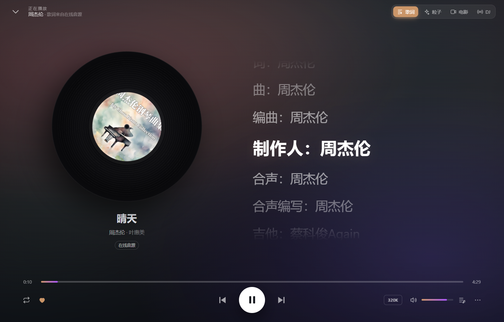
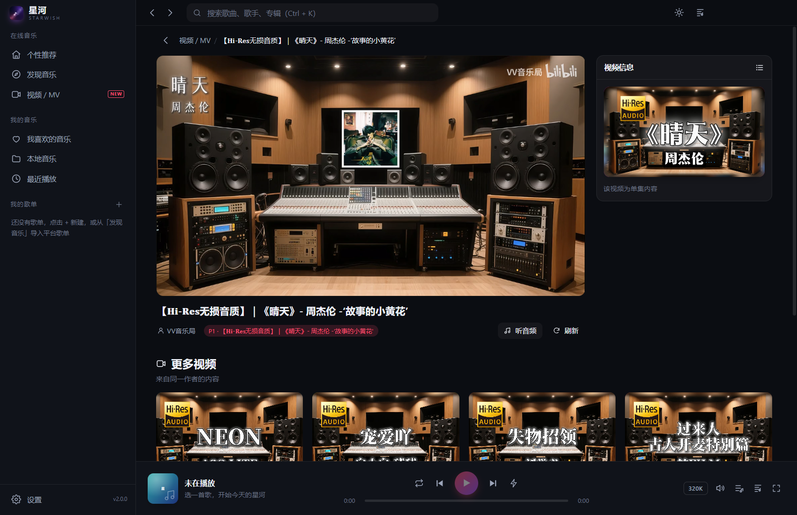
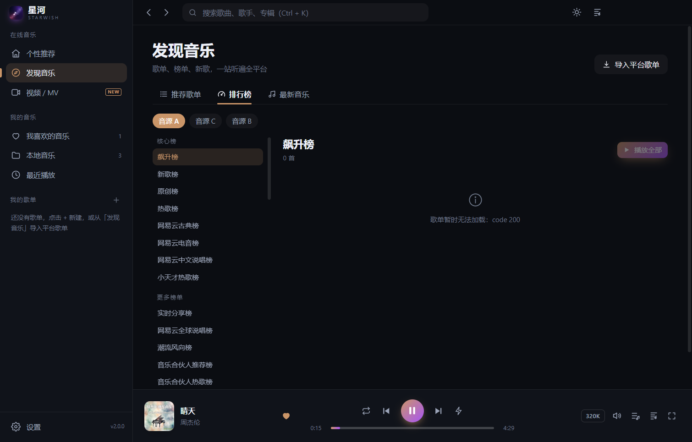
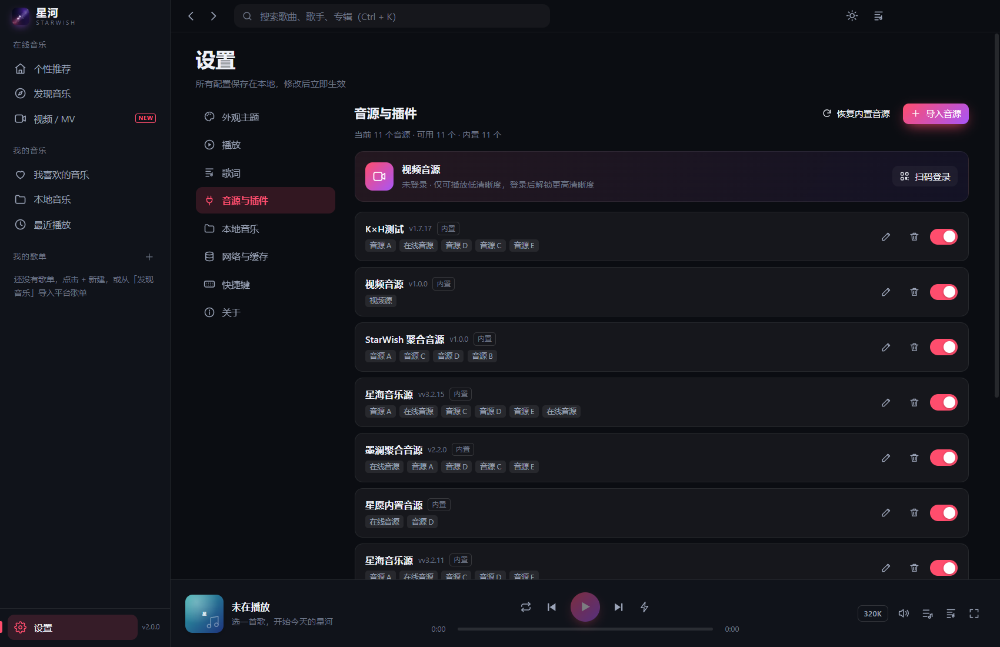
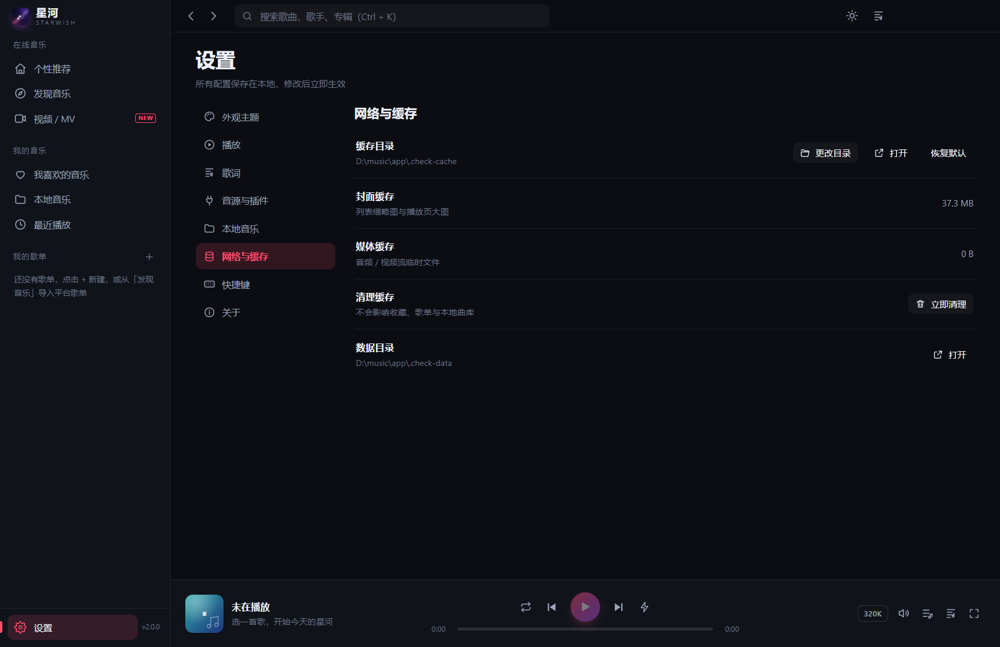

<div align="center">


**把每一次聆听，都汇成一条星河。**

全端音乐播放器 · Windows / macOS / Linux / Android / iOS · 多音源聚合 · 插件市场 · 本地曲库 · 内置视频播放器

</div>

---

## 简介

星河音乐（StarWish Music）是一个**全端音乐播放器**：同一套源码覆盖 Windows / macOS / Linux 桌面与 Android / iOS 移动端（含 Android 平板与车机形态）。它本身不提供任何音乐接口，所有在线内容都来自你导入的 **音源脚本**——音源可以随时启用、停用、移除或恢复，播放器只负责把它们组织成一套顺手的听歌体验。

v2.0 起使用 **Electron + Vue 3 + TypeScript** 重写内核，移动端以 Capacitor 复用同一渲染层：音频解码运行在独立进程里，界面切换、列表滚动都不会打断播放；封面与音视频流统一走本地协议代理，解决了长期困扰的防盗链与跨域问题；歌曲、歌单、收藏、历史全部落盘到 SQLite。

## 界面

| 首页 | 播放页 |
|---|---|
|  |  |

| 视频 / MV（内置播放器 + 分集） | 排行榜 |
|---|---|
|  |  |

| 音源管理 | 网络与缓存 |
|---|---|
|  |  |

## 功能

- **个性推荐**：时段问候、继续收听、每日推荐、私人电台、音乐回忆、热门榜单、心情歌单、新歌速递、播客精选
- **发现音乐**：22 个标签歌单、100+ 榜单（按音源分组）、最新音乐、分享链接一键导入歌单
- **聚合搜索**：多音源 + 插件聚合去重，按相关度排序，平台过滤
- **播放页（v1.0.0 四端分档）**：封面 / 歌词 / 粒子 / 舞台频谱四种视觉模式（按端降级：粒子 200/80/50/0、频谱 64/32/16/0），黑胶 + 真实封面，逐字歌词、翻译、偏移校准；**车机形态**横屏大字琥珀黄、无动效
- **音效与频谱**：Web Audio 音频图（5 段 BiquadFilter + AnalyserNode），6 个 EQ 预设与 5 段 ±12dB 手动调节，实时频谱可视化（车机仅 3 预设）
- **壁纸引擎（图片）**：壁纸库导入多张图，按歌 / 定时 / 随机轮播，可调模糊、遮罩、亮度、填充与缩放
- **播放控制**：音质降级、自动换源、失败跳过、淡入淡出、倍速、定时关闭、队列拖拽
- **我的音乐**：喜欢、本地扫描（标签/内嵌封面/内嵌歌词/同名 LRC）、历史、自建歌单
- **视频 / MV**：内置播放器（非外置弹窗）、分 P 分集切换、超长合集提示、一键转音频、**AB 段循环**、画中画、**弹幕**（自研 Canvas 渲染，可调透明度 / 字号 / 速度 / 区域，支持防挡字幕与屏蔽词）
- **系统**：托盘、媒体键、全局快捷键、桌面歌词（锁定穿透）、任务栏 / 菜单栏单行歌词、开机自启动、侧栏折叠、深浅色、封面主色自适应
- **备份**：WebDAV 单向上传（歌单 + 收藏），支持坚果云 / Nextcloud / 群晖
- **音源管理**：导入 / 启停 / 查看源码 / 移除 / 恢复内置，与用户音源一视同仁
- **缓存管理**：缓存目录可更改、可迁移、可清理

## 架构

```
主进程（Node.js）
├─ 窗口 / 托盘 / 快捷键 / 单实例
├─ IPC 路由 · 音源沙箱 · 平台接口 · SQLite
└─ 播放队列权威状态

渲染进程（Vue 3 + Pinia）        音频宿主（隐藏进程）
├─ 页面 / 组件 / 歌词            ├─ <audio> 解码
└─ 仅通过 preload 通信            └─ 淡入淡出 / 卡死检测

桌面歌词窗口（独立进程，透明置顶）
```

- 自定义协议：`swcover://`（封面代理 + 缓存）、`swmedia://`（音视频流，Range / Referer / Cookie）
- 数据库：SQLite（sql.js），600ms 防抖 + 原子替换落盘
- 音源：lx-music v2 协议，`vm` 沙箱运行，仅能通过宿主 API 请求网络

## 快速开始

```powershell
cd app
npm install
npm run dev        # 开发（Vite + Electron）
npm run build      # 构建
npm run dist:portable
```

产物：`app/dist/release/星河音乐-1.0.0-便携版.exe`，以及免解压的 `星河音乐-1.0.0-x64.zip`；安装版为 `星河音乐 Setup 1.0.0.exe`。

移动端：

```powershell
cd app
npm run build:mobile          # 构建移动端 web 产物
npx cap sync android          # 同步到 Android 工程
cd android && ./gradlew assembleRelease
```

iOS 需在 macOS 上 `npx cap sync ios` 后用 Xcode 打包。仓库已提供 `.github/workflows` 的多端云构建，推送 `v*` 标签即自动产出 Android APK、iOS IPA、Windows、Linux、macOS 全平台产物。

### 打不开 / 双击没反应？

便携版是自解压包，会先解压到系统临时目录。若系统 `%TEMP%` 不可写（受限环境、部分安全软件），自解压会静默失败——**请改用 zip 版**，解压后双击 `星河音乐.exe`。

若任务管理器里已有进程但窗口不出现，说明上一次实例卡住了。v1.0.0 起再点一次图标会自动唤醒（重建窗口或重载渲染进程）；仍无效时可用逃生参数启动：

```powershell
.\星河音乐.exe --force-new
```

排查启动问题时加 `--diagnose`，会在数据目录生成 `boot-trace.json`，记录每个启动阶段的耗时、GPU 降级级别与临时目录。

## 文档

- [正式开发文档](docs/StarWish-Music-正式开发文档.md)
- [新架构说明](docs/StarWish-Music-v2.0-新架构开发文档.md)
- [v1.1 修复清单](docs/v1.1-修复与迭代开发文档.md)
- [音源开发指南](docs/音源开发指南.md)

## 音源

仓库内仅包含自研音源（聚合音源、视频音源）作为示例与开箱即用方案；第三方社区音源请自行获取后通过「设置 → 音源与插件 → 导入音源」加载。音源脚本格式与完整示例见[音源开发指南](docs/音源开发指南.md)。

## 插件库 / 插件市场

v2.1.0 起新增**插件库（插件市场）**，用于管理跨平台的 **MusicFree 协议插件**（支持歌曲 / 专辑 / 歌手 / 歌单 / 歌词等多类型检索），与内置的 lx-music 音源并行工作、互不影响——内置音源保持原样，插件库是可在线安装的额外音源扩展。

### 在哪里用

「设置 → 音源与插件 → 插件库」。支持三种方式获取插件：

- **插件市场**：浏览在线目录、查看版本与支持类型，一键安装 / 更新 / 卸载
- **订阅源**：填入订阅地址后自动同步目录，插件更新只需刷新订阅
- **本地导入**：从本地文件或直接粘贴 / 填写插件网址导入

### 插件库地址（GitHub 独立分支存储库）

官方插件库托管在本仓库的独立分支 **`Star-Wish-Plugin-Library`**，与主分支代码隔离，便于独立迭代与版本更新：

- **仓库**：https://github.com/mancking/StarWish-Music
- **插件库分支**：https://github.com/mancking/StarWish-Music/tree/Star-Wish-Plugin-Library
- **目录索引（manifest.json）**：https://raw.githubusercontent.com/mancking/StarWish-Music/Star-Wish-Plugin-Library/manifest.json

`manifest.json` 是插件市场的目录索引，每条记录包含插件名、文件名、版本、作者、支持的检索类型（types）以及插件源码的 raw 下载地址。客户端（设置页）拉取该索引即可展示可安装列表；订阅源也复用同一格式，因此可指向该分支或任意自建镜像。

### 插件来源与参考源码

- **插件不内置**：安装后插件库为空，插件一律由用户从「插件市场」/「订阅源」/「本地导入」安装，安装后存放于用户插件目录，可随时更新替换与卸载。
- **官方在线插件**：托管于上述 `Star-Wish-Plugin-Library` 分支，共 9 个：网易云、B站、5sing、音悦台、歌词千寻、小枸、小秋、小蜗、小云。
- **插件协议**：采用 MusicFree 插件协议（`search` / `getLyric` / `getMusicUrl` 等导出方法），运行在主进程的 `vm` 沙箱内，仅通过宿主注入的依赖（`axios` / `cheerio` / `crypto-js` / `dayjs` / `qs`）发起网络请求。
- **插件宿主实现**：[`app/electron/core/mf-host.ts`](app/electron/core/mf-host.ts)（加载 / 求值 / 调用 / 订阅解析）。插件运行时依赖与 IPC 通道见 [`app/electron/ipc.ts`](app/electron/ipc.ts)（`plugins:*`）。
- **插件市场 / 导入 UI**：[`app/src/pages/Settings.vue`](app/src/pages/Settings.vue) 的「插件库」区块。
- **插件开发**：插件本质是一个导出若干方法的 JS 文件，可直接参考 `Star-Wish-Plugin-Library` 分支中的任意插件源码；本地调试时用「本地导入」加载即可。

> 说明：插件库与音源是两套并列机制。音源走 lx-music v2 协议（`app/sources/*.js`），插件走 MusicFree 协议（在线插件），两者可在聚合搜索中共同参与，也可各自单独启停。

## 说明

- 本项目不内置、不托管任何音频文件，所有在线内容由用户导入的音源提供。
- 音乐版权归各平台与版权方所有，本软件仅供个人学习与试听，请勿用于商业用途。
- 界面中不出现任何官方音乐软件名称或标识，所有数据统一标注为「在线音源 / 本地音源 / 音源插件」。

## License

[MIT](LICENSE)
