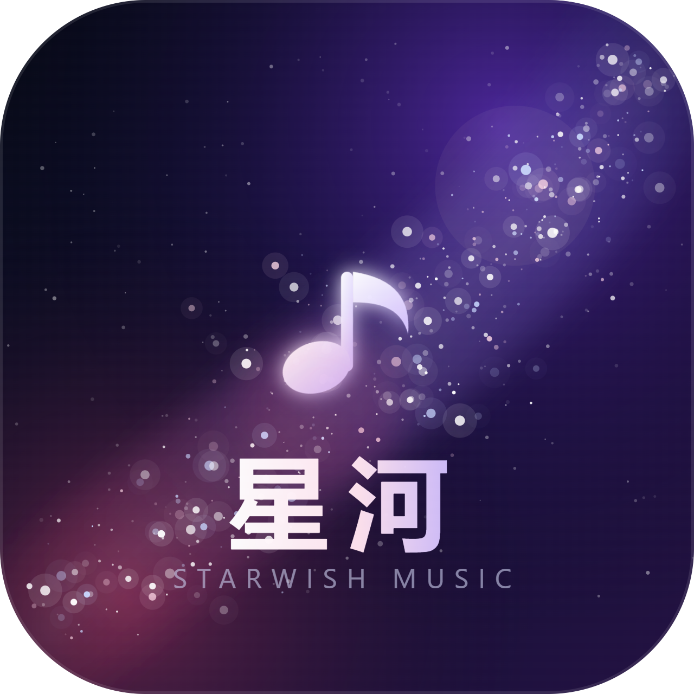

# 星河音乐 StarWish Music

> 星河入耳，愿有所响。

多音源聚合桌面音乐播放器。**v2.0 使用全新架构重写**：Electron 主进程 + Vue 3 / TypeScript 渲染进程 + 独立音频宿主进程 + SQLite，彻底替代 v1.1 的「本地 HTTP 服务 + 原生 JS 页面」。



## 为什么重写

旧版把 UI、播放、网络请求全塞在同一个页面里，导致卡顿、白屏、切页断播、封面 403、收藏丢失。v2.0 的改造：

- **进程隔离**：音频解码在隐藏的独立渲染进程，UI 卡顿不影响播放，崩溃自动重建。
- **组件化 UI**：Vue 3 + Pinia，页面状态可预测，路由切换不丢数据。
- **协议代理**：封面走 `swcover://`、音视频走 `swmedia://`，主进程注入 Referer / Cookie / Range，彻底解决防盗链与跨域。
- **SQLite 持久化**：歌曲、歌单、收藏、历史、播放次数、设置全部落库。
- **全链路兜底**：取链降级 → 自动换源 → 同曲重试 → 跳歌；全局错误边界与文件日志。

## 功能

- 首页：问候、继续收听、推荐歌单、每日推荐、热门榜单、心情歌单、新歌、播客
- 发现：标签歌单、网易云 / QQ / 酷狗榜单树（100+ 榜单）
- 搜索：网易云 + QQ + 酷狗 + 插件聚合，相关度排序
- 播放页：黑胶 + 真实封面、歌词 / 粒子 / 电影 / 播客四舞台、逐字歌词、队列拖拽
- 我的音乐：喜欢、本地扫描（标签/封面/内嵌歌词）、历史、自建歌单、平台歌单导入
- 视频 / MV：B 站视频播放，可一键切音频
- 系统：托盘、媒体键、全局快捷键、桌面歌词、深浅色、封面主色自适应、B 站扫码登录

## 开发

```powershell
npm install
npm run dev        # Vite + Electron 热更新
npm run build      # 构建渲染层与主进程
npm run start      # 构建后启动
npm run typecheck  # 类型检查
```

## 打包

```powershell
npm run dist              # 便携版 + 安装版
npm run dist:portable     # 仅便携版
```

产物在 `dist/release/`：

- `星河音乐-2.0.0-便携版.exe`
- `星河音乐-2.0.0-安装版.exe`

## 测试

```powershell
npx electron --no-sandbox scripts/smoke.cjs
```

会自动启动真实应用、逐页截图到 `dist/smoke/`，并验证：首页渲染、搜索、点击播放、歌词匹配、收藏、榜单、MV，最后汇总控制台错误数（要求为 0）。

## 目录

```
electron/   主进程、IPC、音频宿主、音源沙箱、平台接口、数据库
src/        Vue 渲染层（pages / components / stores）
shared/     共享类型与 LRC 解析
sources/    内置音源脚本（11 个）
resources/  品牌图标与封面
scripts/    构建 / 图标生成 / 冒烟测试
```

详细设计见 `../docs/StarWish-Music-v2.0-新架构开发文档.md`。

## 说明

- 音源脚本可自由导入 / 停用 / 删除；本仓库不内置任何受版权保护的音频文件。
- 所有音乐版权归各平台与版权方所有，本软件仅供个人学习与试听。
